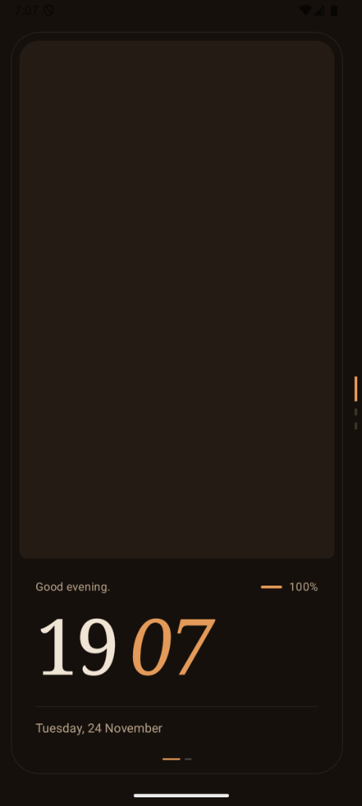
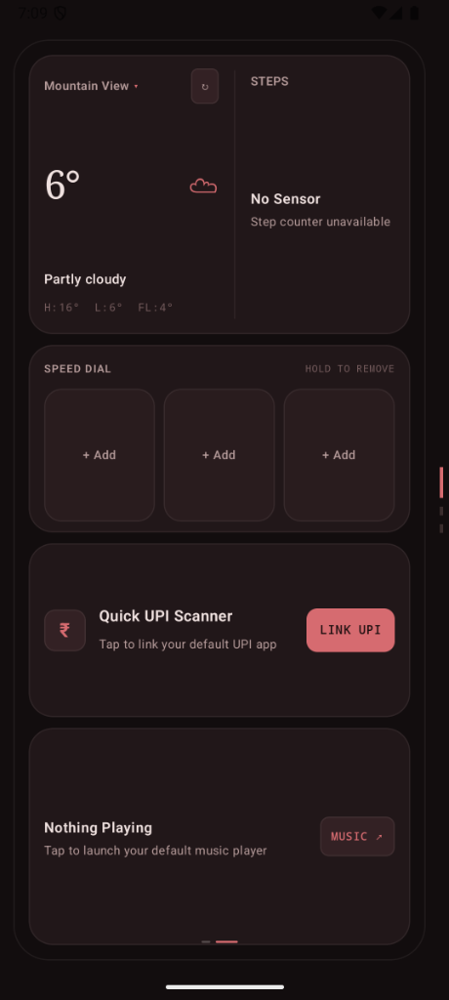
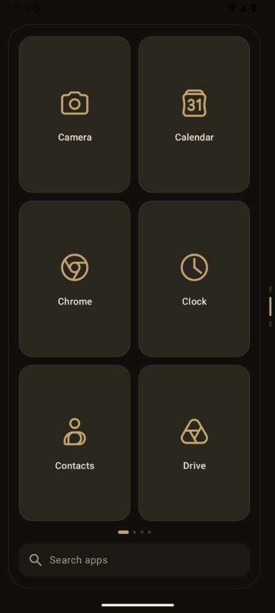
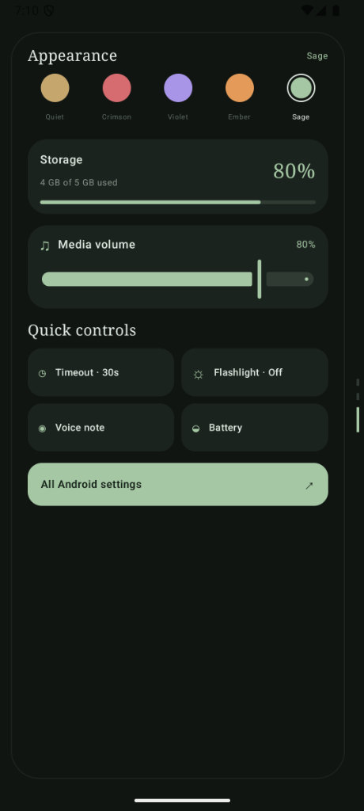

# SwayLauncher

<p align="center">
  
  
  
  
</p>

<p align="center">
  <strong>A calm, tactile, and intentional Android Home launcher built with Kotlin and Jetpack Compose.</strong>
</p>

<p align="center">
  
  
  
  
  
</p>

---

## Overview

**SwayLauncher** replaces home-screen clutter with a focused, card-driven experience designed to prioritize signal over noise. Built entirely with **Jetpack Compose** and modern Android architecture, it unites an ambient clock, personal productivity dashboard, high-performance app drawer, and system-level telemetry into three vertically swipeable surfaces with tactile spring dynamics.

---

## Showcase

| **Your Space** | **Personal Dashboard** | **Your Apps** | **System Deck** |
|:---:|:---:|:---:|:---:|
|  |  |  |  |
| *Ambient clock, greeting, battery gauge, and photo frame* | *Weather, hardware steps, speed dial, UPI dock & music* | *2×3 paginated drawer, debounced search & Lawnicons* | *Palette switcher, storage meter & hardware toggles* |

---

## Key Features

### 🕒 1. Your Space
* **Editorial Clock:** Large split-baseline typography pairing modern sans-serif hours with light italic serif minutes.
* **Ambient Telemetry:** Contextual time-of-day greetings and battery level indicator updated via event-driven system broadcast receivers (zero polling overhead).
* **Photo Frame Wallpaper:** Optional custom photo card integration using Android's `OpenDocument` contract with persistable URI permissions and sub-sampled bitmap decoding to prevent OOM errors.
* **Direct System Shortcuts:** Instant tap targets to launch the default clock/alarm and calendar applications.

### 📊 2. Personal Dashboard
* **Ambient Weather Console:** Real-time weather and temperature tracking powered by the Open-Meteo REST API, featuring reverse geocoding (`Geocoder`), GPS/network location support, 30-minute caching, and a manual city selector.
* **Hardware Step Counter:** Continuous pedometer tracking using Android's `Sensor.TYPE_STEP_COUNTER` with 5-second hardware FIFO batching (`maxReportLatencyUs`) to keep the CPU asleep. Includes resilient mid-day reboot detection (`BOOT_COUNT`) and midnight epoch-day rollover calculations.
* **Speed Dial Strip:** Instant one-tap calling for up to three favorite contacts selected via `ACTION_PICK`, complete with custom initials avatars and long-press removal.
* **Express UPI Dock:** Automatically discovers installed UPI payment apps (`upi://`), detects deep QR scanner shortcut targets (`LauncherApps.ShortcutQuery`), and launches directly into payment scanning mode.
* **Now Playing Studio Deck:** Live audio playback controls using `NotificationListenerService` and `MediaSessionManager`, displaying track metadata, high-resolution album artwork, and interactive transport buttons (Play/Pause/Skip/Previous).

### 📱 3. Your Apps (Paginated Drawer)
* **2×3 Card Grid:** Clean, consistent slot sizing designed for distraction-free navigation with spring-based page snapping.
* **Adaptive Lawnicons Integration:** Automatically resolves and normalizes matching Lawnicons SVGs with an 8% inset margin via `AndroidSVG`, falling back gracefully to adaptive/monochrome system icons.
* **Multi-Tier Caching:** Backed by an in-memory LRU bitmap cache and a persistent SQLite database (`app_icons.db`) for near-instant cold startups.
* **Zero-Recomposition Search:** Real-time debounced fuzzy search (`150ms`) with IME insets animated through `Modifier.graphicsLayer` to avoid unnecessary recomposition cycles during keyboard appearance.
* **Contextual App Actions:** Long-press bottom action sheet featuring custom Canvas-drawn vector glyphs for quick access to App Info and uninstallation.

### 🎛️ 4. Your System Deck
* **Curated Color Palettes:** Five reactive color themes with live switching and persistence:
  * **Quiet** (Warm editorial tones)
  * **Crimson** (Deep burgundy accents)
  * **Violet** (Atmospheric twilight purple)
  * **Ember** (Warm energetic ochre)
  * **Sage** (Calm, earthy forest green)
* **Storage Telemetry:** Real-time internal storage measurement and visual progress indicator calculated via `StatFs`.
* **Hardware-Synced Volume Slider:** Bidirectionally bound to `android.media.VOLUME_CHANGED_ACTION` so physical volume buttons remain perfectly in sync with the Compose UI.
* **Direct Hardware Controls:**
  * Screen timeout cycler (30s, 1m, 2m, 5m, 10m) managing `Settings.System.SCREEN_OFF_TIMEOUT`.
  * Flashlight toggle powered by `CameraManager.setTorchMode` with continuous `TorchCallback` observation.
  * Instant speech-to-text voice note capture via `RecognizerIntent` with automatic clipboard copy.
  * Direct shortcut to Android battery saver & system settings.

---

## Technical Highlights & Engineering Design

* **Continuous Modulo Pager:** Infinite vertical navigation loop implemented with Compose `VerticalPager` and `Spring.DampingRatioNoBouncy` physics.
* **Battery-Conscious Sensors:** Hardware FIFO sensor event batching eliminates CPU wakeups during continuous daily step tracking.
* **Off-Main-Thread Processing:** Search ranking, icon SVG letterboxing, and SQLite upserts run purely on background coroutine dispatchers (`Dispatchers.IO` / `Dispatchers.Default`).
* **Optimized Compose Rendering:** Avoids frequent recompositions by delegating dynamic animations (IME keyboard translation, pager swipe alphas, search bar focus rings) to the graphics draw phase via `graphicsLayer` and `drawBehind`.

---

## Technology Stack

* **Language:** Kotlin 2.2.10
* **UI Framework:** Jetpack Compose with Material 3
* **Build System:** Gradle 9.6.0 with Android Gradle Plugin 9.5.0
* **Persistence:** SQLite (`SQLiteOpenHelper`) & `SharedPreferences`
* **Concurrency:** Kotlin Coroutines & `StateFlow`
* **SVG Rendering:** AndroidSVG
* **Networking:** Standard `HttpURLConnection` targeting Open-Meteo REST APIs
* **Android SDK:**
  * `minSdk`: 26 (Android 8.0 Oreo)
  * `targetSdk`: 37
  * `compileSdk`: 37

---

## Project Structure

```text
app/
├── src/main/java/com/me/mylauncher/
│   ├── MainActivity.kt                 # Entry point and Android RoleManager negotiation
│   ├── navigation/
│   │   └── LauncherHome.kt             # Vertical spring pager & right-edge telemetry rail
│   ├── data/
│   │   ├── LauncherApp.kt              # Application lifecycle & repository initialization
│   │   ├── AppRepository.kt            # App discovery, launcher callbacks, ranking & caching
│   │   ├── AppDatabase.kt              # SQLite store for app metadata, launch counts & icons
│   │   ├── IconResolver.kt             # Lawnicons XML parser, SVG letterboxing & LRU cache
│   │   └── LauncherApp.kt              # Application subclass
│   ├── sections/
│   │   ├── YourSpace.kt                # Timepiece, photo frame wallpaper & event receivers
│   │   ├── YourApps.kt                 # Searchable paginated app grid & action sheet
│   │   ├── PersonalDashboard.kt        # Weather, pedometer, speed dial, UPI & media player
│   │   ├── SystemDeck.kt               # Palettes, storage meter, volume & hardware tiles
│   │   ├── LauncherColors.kt           # Color palettes, design tokens & typography
│   │   └── PriorityNotificationListener.kt # Notification listener service
│   ├── components/
│   │   └── CardController.kt           # Shared card framing, borders & padding
│   └── ui/theme/                       # MaterialTheme definitions
├── src/main/assets/lawnicons/          # Lawnicons appfilter mappings & SVGs
├── screenshots/                        # Documentation screenshots
└── THIRD_PARTY_NOTICES.md              # Third-party licensing attribution
```

---

## Permissions & Access

| Capability | Purpose |
| :--- | :--- |
| `ROLE_HOME` | Enables SwayLauncher to operate as the device default home launcher. |
| `QUERY_ALL_PACKAGES` / `LauncherApps` | Discovers installed applications and receives package install/uninstall events. |
| `BIND_NOTIFICATION_LISTENER_SERVICE` | Powers active media session discovery, playback controls, and track metadata. |
| `ACTIVITY_RECOGNITION` | Reads the hardware step counter sensor for the daily pedometer. |
| `ACCESS_COARSE_LOCATION` | Automatically detects device location for local weather forecasts. |
| `INTERNET` | Fetches weather forecasts and city geocoding data from Open-Meteo. |
| `WRITE_SETTINGS` | Allows direct screen timeout adjustment from the System Deck. |
| `Contacts Picker` | Uses system contract to select speed-dial contacts without broad contact read permissions. |
| `UPI Intent Queries` | Discovers installed payment apps that handle `upi://` URI schemes. |

---

## Getting Started

1. Clone the repository:
   ```bash
   git clone https://github.com/Dhakshin27/Sway-Launcher.git
   ```
2. Open the project in **Android Studio Ladybug** or newer.
3. Allow Gradle to sync dependencies.
4. Select an Android device or emulator running **Android 8.0 (API 26)** or higher.
5. Build and run the `app` configuration.
6. When prompted by Android, select **SwayLauncher** and choose **Always** to set it as your default home app.

---

## Third-Party Assets & Attribution

* **Icons:** Includes icon mappings and SVG assets from [Lawnicons](https://github.com/LawnchairLauncher/lawnicons) (Apache License 2.0).
* **Weather Data:** Powered by [Open-Meteo](https://open-meteo.com/) non-commercial weather APIs.
* Full license text and notices are available in [`THIRD_PARTY_NOTICES.md`](app/THIRD_PARTY_NOTICES.md).

---

## License

Distributed under the Apache License, Version 2.0. See [`LICENSE`](app/src/main/assets/lawnicons/LICENSE) for more details.
